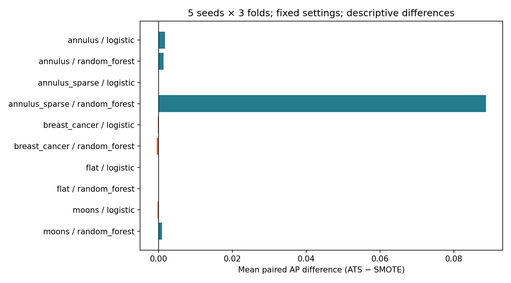
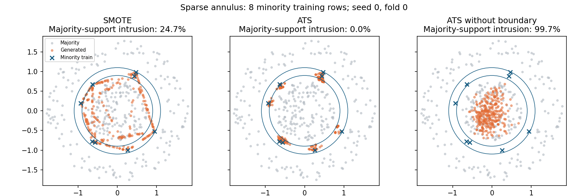
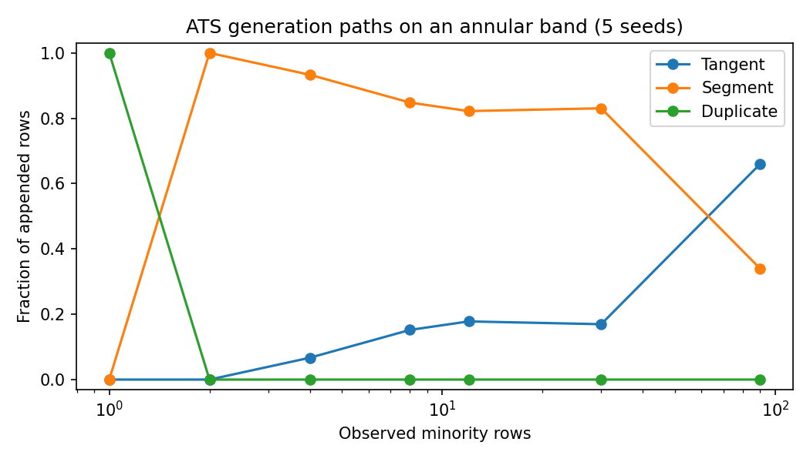
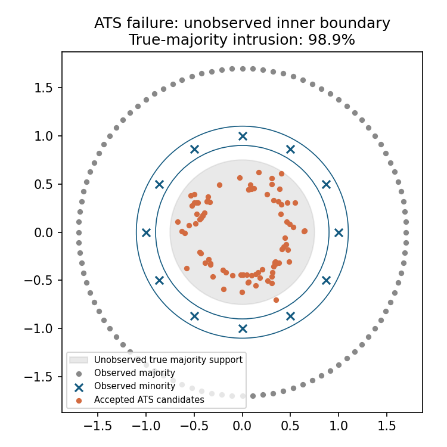

# Recorded evaluation results

Five seeds (0–4) × 3 stratified folds; fixed defaults; no tuning. AP = average precision. Values are descriptive means ± fold standard deviations; the overlapping folds are not independent trials.

## Average precision: all methods

### logistic

| Method | annulus | annulus_sparse | breast_cancer | flat | moons |
|---|---:|---:|---:|---:|---:|
| none | 0.1992 ± 0.0209 | 0.0283 ± 0.0074 | 0.9943 ± 0.0042 | 1.0000 ± 0.0000 | 0.8875 ± 0.0336 |
| class_weight | 0.1987 ± 0.0204 | 0.0285 ± 0.0073 | 0.9940 ± 0.0041 | 1.0000 ± 0.0000 | 0.8876 ± 0.0335 |
| random_over | 0.1994 ± 0.0243 | 0.0290 ± 0.0086 | 0.9930 ± 0.0043 | 1.0000 ± 0.0000 | 0.8873 ± 0.0339 |
| smote | 0.1954 ± 0.0196 | 0.0279 ± 0.0072 | 0.9941 ± 0.0045 | 1.0000 ± 0.0000 | 0.8863 ± 0.0338 |
| borderline_smote | 0.1531 ± 0.0161 | 0.0300 ± 0.0073 | 0.9939 ± 0.0046 | 0.9999 ± 0.0004 | 0.8649 ± 0.0412 |
| adasyn | 0.1582 ± 0.0188 | 0.0278 ± 0.0073 | 0.9923 ± 0.0042 | 0.9999 ± 0.0003 | 0.8555 ± 0.0410 (14/15) |
| ats | 0.1972 ± 0.0173 | 0.0280 ± 0.0065 | 0.9940 ± 0.0042 | 1.0000 ± 0.0000 | 0.8860 ± 0.0349 |
| ats_fixed_dim | 0.1988 ± 0.0205 | 0.0280 ± 0.0065 | 0.9942 ± 0.0041 | 1.0000 ± 0.0000 | 0.8856 ± 0.0346 |
| ats_no_boundary | 0.1976 ± 0.0192 | 0.0293 ± 0.0091 | 0.9943 ± 0.0043 | 1.0000 ± 0.0000 | 0.8859 ± 0.0350 |
| ats_no_fallback | failed (0/15) | failed (0/15) | failed (0/15) | 1.0000 ± 0.0000 (4/15) | failed (0/15) |
| geometric_smote | 0.1952 ± 0.0202 | 0.0288 ± 0.0078 | 0.9938 ± 0.0047 | 1.0000 ± 0.0000 | 0.8862 ± 0.0335 |
| loras | 0.1987 ± 0.0204 | 0.0266 ± 0.0048 | 0.9944 ± 0.0042 | 1.0000 ± 0.0000 | 0.8879 ± 0.0334 |

### random_forest

| Method | annulus | annulus_sparse | breast_cancer | flat | moons |
|---|---:|---:|---:|---:|---:|
| none | 0.9742 ± 0.0191 | 0.1879 ± 0.1114 | 0.9884 ± 0.0058 | 1.0000 ± 0.0000 | 0.9836 ± 0.0157 |
| class_weight | 0.9680 ± 0.0245 | 0.3200 ± 0.2068 | 0.9894 ± 0.0051 | 1.0000 ± 0.0000 | 0.9841 ± 0.0149 |
| random_over | 0.9790 ± 0.0130 | 0.3114 ± 0.1994 | 0.9888 ± 0.0050 | 1.0000 ± 0.0000 | 0.9870 ± 0.0136 |
| smote | 0.9826 ± 0.0150 | 0.3401 ± 0.3109 | 0.9893 ± 0.0059 | 1.0000 ± 0.0000 | 0.9877 ± 0.0128 |
| borderline_smote | 0.9760 ± 0.0198 | 0.2522 ± 0.2218 | 0.9875 ± 0.0060 | 1.0000 ± 0.0000 | 0.9883 ± 0.0153 |
| adasyn | 0.9777 ± 0.0170 | 0.3057 ± 0.2520 | 0.9886 ± 0.0058 | 1.0000 ± 0.0000 | 0.9909 ± 0.0135 (14/15) |
| ats | 0.9840 ± 0.0124 | 0.4288 ± 0.2187 | 0.9888 ± 0.0053 | 1.0000 ± 0.0000 | 0.9887 ± 0.0131 |
| ats_fixed_dim | 0.9822 ± 0.0132 | 0.4288 ± 0.2187 | 0.9886 ± 0.0055 | 1.0000 ± 0.0000 | 0.9865 ± 0.0150 |
| ats_no_boundary | 0.9804 ± 0.0147 | 0.0352 ± 0.0080 | 0.9890 ± 0.0056 | 1.0000 ± 0.0000 | 0.9890 ± 0.0129 |
| ats_no_fallback | failed (0/15) | failed (0/15) | failed (0/15) | 1.0000 ± 0.0000 (4/15) | failed (0/15) |
| geometric_smote | 0.9882 ± 0.0100 | 0.3618 ± 0.2453 | 0.9894 ± 0.0051 | 1.0000 ± 0.0000 | 0.9926 ± 0.0088 |
| loras | 0.9808 ± 0.0134 | 0.2975 ± 0.2686 | 0.9888 ± 0.0053 | 1.0000 ± 0.0000 | 0.9872 ± 0.0127 |

## ATS versus SMOTE

| Dataset | Model | ATS AP | SMOTE AP | Δ AP | ATS recall | ATS FPR | ATS Brier |
|---|---|---:|---:|---:|---:|---:|---:|
| annulus | logistic | 0.1972 | 0.1954 | +0.0018 | 0.5644 | 0.4569 | 0.2488 |
| annulus | random_forest | 0.9840 | 0.9826 | +0.0014 | 0.9467 | 0.0249 | 0.0244 |
| annulus_sparse | logistic | 0.0280 | 0.0279 | +0.0001 | 0.3167 | 0.4689 | 0.2499 |
| annulus_sparse | random_forest | 0.4288 | 0.3401 | +0.0887 | 0.3167 | 0.0111 | 0.0256 |
| breast_cancer | logistic | 0.9940 | 0.9941 | -0.0001 | 0.9633 | 0.0157 | 0.0201 |
| breast_cancer | random_forest | 0.9888 | 0.9893 | -0.0005 | 0.9453 | 0.0364 | 0.0339 |
| flat | logistic | 1.0000 | 1.0000 | +0.0000 | 1.0000 | 0.0000 | 0.0043 |
| flat | random_forest | 1.0000 | 1.0000 | +0.0000 | 1.0000 | 0.0000 | 0.0008 |
| moons | logistic | 0.8860 | 0.8863 | -0.0003 | 0.8756 | 0.1071 | 0.0772 |
| moons | random_forest | 0.9887 | 0.9877 | +0.0010 | 0.9867 | 0.0102 | 0.0110 |

## Failures (not imputed)

- adasyn, moons: 2 model-evaluation rows; `RuntimeError: Not any neigbours belong to the majority class. This case will induce a NaN case with a division by zero. ADASYN is not suited for this specific dataset. Use SMOTE instead.`
- ats_no_fallback, annulus: 30 model-evaluation rows; `SamplingError: Tangent sampling failed and allow_fallback=False; inspect diagnostics_ for partial progress.`
- ats_no_fallback, annulus_sparse: 30 model-evaluation rows; `SamplingError: Tangent sampling failed and allow_fallback=False; inspect diagnostics_ for partial progress.`
- ats_no_fallback, breast_cancer: 30 model-evaluation rows; `SamplingError: Tangent sampling failed and allow_fallback=False; inspect diagnostics_ for partial progress.`
- ats_no_fallback, flat: 22 model-evaluation rows; `SamplingError: Tangent sampling failed and allow_fallback=False; inspect diagnostics_ for partial progress.`
- ats_no_fallback, moons: 30 model-evaluation rows; `SamplingError: Tangent sampling failed and allow_fallback=False; inspect diagnostics_ for partial progress.`

## Interpretation and limits

A positive AP difference is dataset/model specific. Negative differences are retained. Resampling changes training priors; Brier scores are uncalibrated. The safety rule uses observed training distances and does not prove class membership.

No-fallback failures mean the requested count could not be filled using tangent sampling alone. Partial-success ablation averages are selection-biased and are not evidence of superiority. See `summary.csv` for success counts and all metrics.

Sparse annular supports can be bridged even by an accepted candidate: limited majority observations do not identify the true boundary. Inspect the fixed seed-0/fold-0 plot and `scarcity.csv`; no favorable plot was selected by score.

Simplicial SMOTE is absent because the author-linked repository was empty when checked. LoRAS uses pyloras, not an exact author-code reproduction. These are small benchmarks with one real dataset, not a comprehensive ranking or novelty claim.

## Explicit ATS failure: missing boundary observations

An adversarial sample contains 12 minority points on the unit circle and 100 majority points on radius 1.7, with no observations in the true inner majority disk (radius ≤ 0.75). Default ATS with seed 0 accepts 88 candidates; 87 (98.86%) enter that disk. All pass the observed-distance rule. This counterexample is separate from the five-dataset CV ranking and demonstrates why acceptance does not guarantee true class membership.

